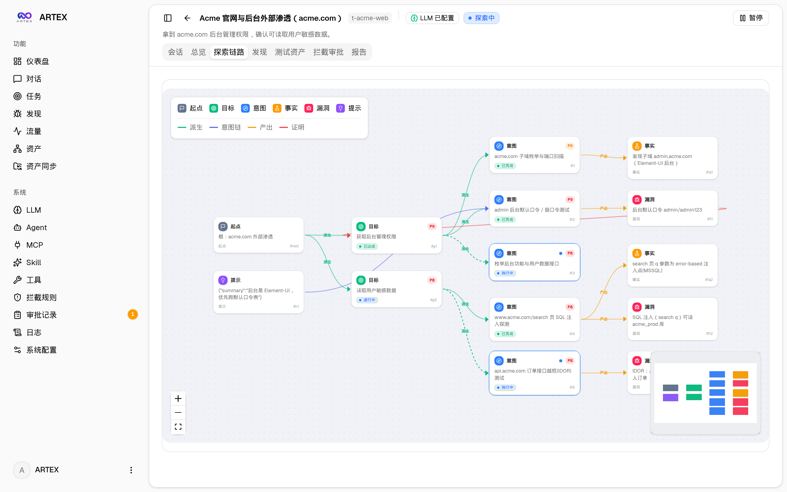
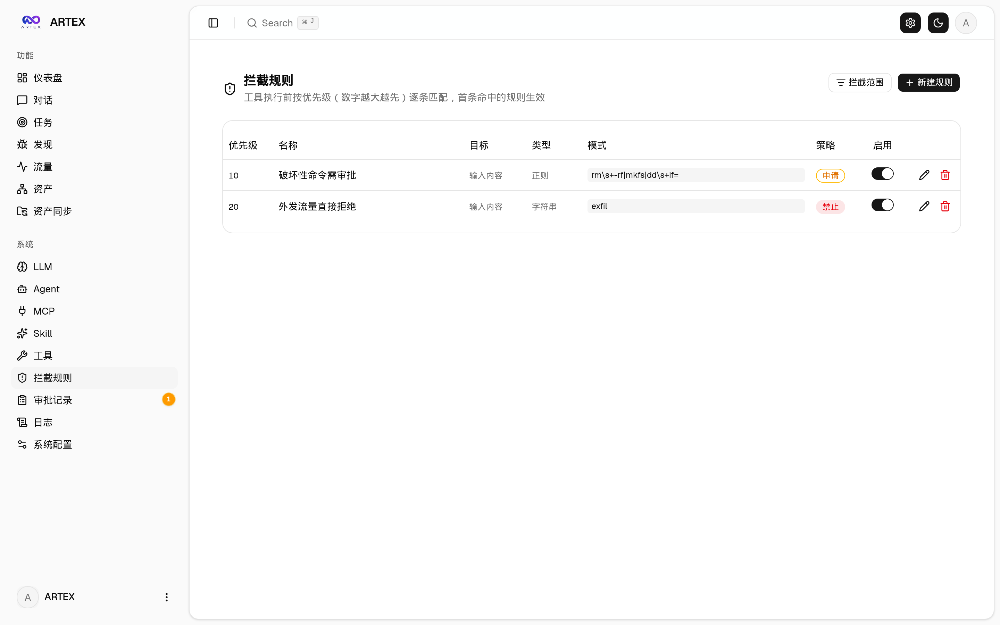
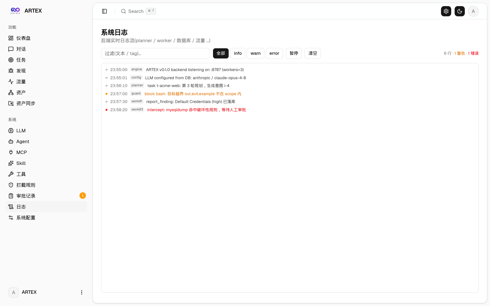
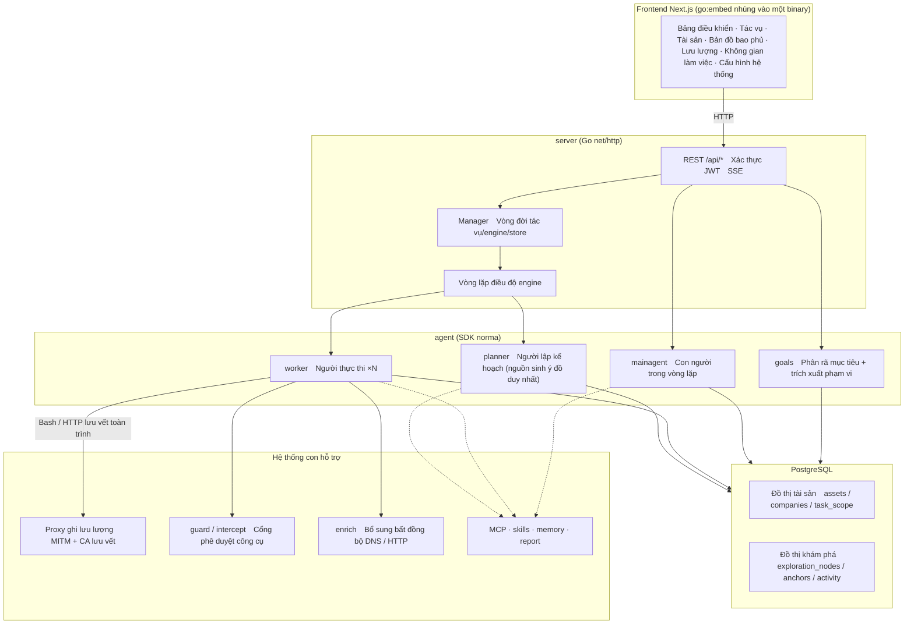
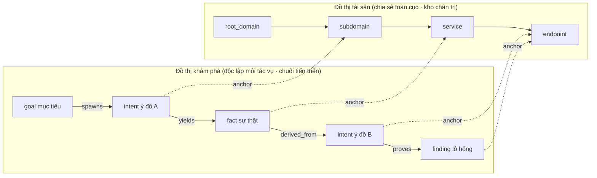
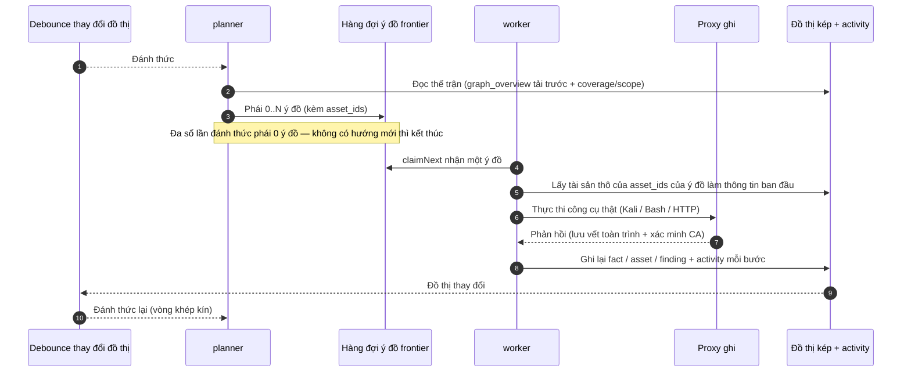
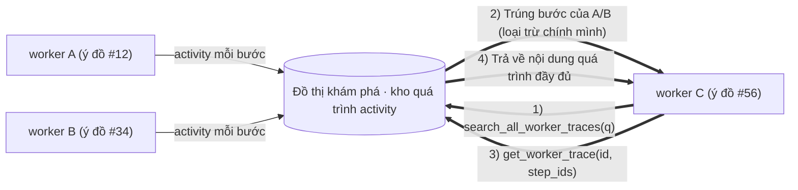
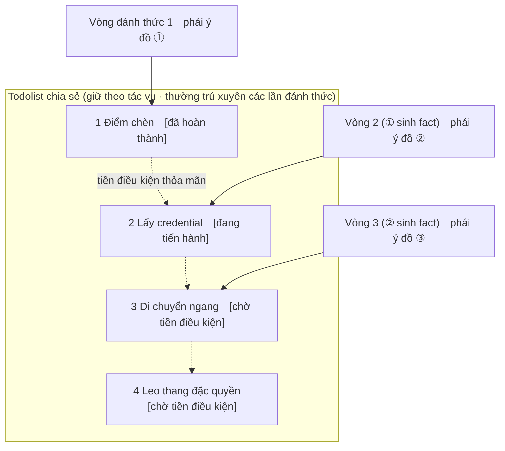

<div align="center">

# ARTEX

Hệ thống kiểm thử xâm nhập tự chủ bằng AI (backend Go + frontend Next.js)


🌐 **Demo trực tuyến**: [https://artex-demo.vercel.app/](https://artex-demo.vercel.app/)

</div>

---

## Xem trước ảnh chụp màn hình

> Xem tương tác đầy đủ tại [Demo trực tuyến](https://artex-demo.vercel.app/).

| Bảng điều khiển (Tổng quan / Tiêu thụ Token / Luồng hoạt động) | Danh sách tác vụ |
| :---: | :---: |
|  |  |

| Tác vụ · Quá trình thực thi (phiên / gọi công cụ) | Chuỗi khám phá |
| :---: | :---: |
|  |  |

| Phát hiện | Tài sản |
| :---: | :---: |
|  |  |

| Bản đồ bao phủ tài sản (bố cục force-directed · tô sáng đã kiểm thử · thu gọn/mở rộng nút) |
| :---: |
|  |

| Ghi lưu lượng | Hội thoại con người trong vòng lặp |
| :---: | :---: |
|  |  |

| Quản lý Agent | Cấu hình LLM |
| :---: | :---: |
|  |  |

| Phê duyệt chặn | Nhật ký backend |
| :---: | :---: |
|  |  |


---

## Chi tiết bản ghi phê duyệt

「Bản ghi phê duyệt」toàn cục, 「Phê duyệt chặn」trong tác vụ và thẻ phê duyệt trong hội thoại đều hỗ trợ mở rộng để xem chi tiết. Cấu trúc hiển thị tham khảo
[component chi tiết phê duyệt của AegisHook](https://github.com/RuoJi6/AegisHook/blob/main/web/src/components/CallDetail.vue), tiếp tục dùng component và theme của ARTEX:


## Đồng bộ tài sản (ScopeSentry)

Hỗ trợ đồng bộ dữ liệu tài sản trực tiếp từ [ScopeSentry](https://github.com/Autumn-27/ScopeSentry), không cần thu thập lặp lại:

- Ở trang 「**Đồng bộ tài sản**」điền địa chỉ và API Key của ScopeSentry để kết nối nguồn dữ liệu;
- Chọn mục tiêu và loại tài sản cần đồng bộ theo chiều **dự án** hoặc **tác vụ** (tên miền / tên miền con / IP / cổng / site / endpoint…);
- Nhập một chạm và gộp theo phạm vi tài sản công ty, đưa thẳng vào đồ thị tài sản của ARTEX để agent khám phá sử dụng.

---

## Cài đặt

> Phụ thuộc cơ sở dữ liệu **PostgreSQL**; khám phá cần cấu hình **LLM** (`ANTHROPIC_API_KEY` hoặc `OPENAI_API_KEY`, cũng có thể cấu hình trong UI).

### Cách 1: Script cài đặt một chạm (khuyến nghị)

```bash
git clone https://github.com/Hinln/ARTEX.git
cd ARTEX
./install.sh
```

Script sẽ: phát hiện / tự động cài Docker → cho bạn chọn **① Toàn bộ Docker** hoặc **② Biên dịch chạy cục bộ**:

- **① Toàn bộ Docker**: nhập một mật khẩu Postgres (có thể Enter để ngẫu nhiên) → tự động ghi `.env` → `docker compose up -d`.
- **② Chạy cục bộ**: chọn cơ sở dữ liệu (kết nối có sẵn / dùng Docker khởi một cái) → sinh `config.json` → `go` biên dịch thành một binary nhúng → khởi động.

Sau khi cài xong mở **http://localhost:8787** (lần đầu vào `/setup` để đặt mật khẩu quản trị viên).

### Cách 2: Docker Compose (thủ công)

```bash
git clone https://github.com/Hinln/ARTEX.git
cd ARTEX
cp .env.example .env          # điền POSTGRES_PASSWORD, tùy chọn ANTHROPIC_API_KEY
docker compose up -d          # tải về image autumn27/artex + postgres
# → http://localhost:8787
```

Image đã bao gồm các công cụ thường dùng (ripgrep/curl/vim/npm/nmap…); `./skills` và `./data` được bền vững qua bind mount.

MCP từ xa có thể chọn `http` (Streamable HTTP) hoặc `sse` (SSE phiên bản cũ) trong cài đặt hệ thống.
Dịch vụ SSE phiên bản cũ thường dùng `GET /sse` để thiết lập luồng sự kiện, sau đó nhận yêu cầu JSON-RPC qua
`/message?sessionId=...` mà dịch vụ trả về; khi cấu hình điền URL là `/sse`, header yêu cầu điền theo dạng
`Authorization=Bearer <token>`.

### Cách 3: Tải xuống binary biên dịch sẵn (Releases)

Vào [Releases](https://github.com/Hinln/ARTEX/releases) tải zip tương ứng nền tảng, giải nén được `artex` + `start.sh` (Windows là `start.bat`) + `skills/` + `config.example.json`:

```bash
cp config.example.json config.json   # điền kết nối database
./start.sh                           # → http://localhost:8787
```

> Hãy dùng `start.sh` / `start.bat` để khởi động, thay vì chạy trực tiếp `./artex`. Đó là một script daemon: sau khi chương trình thoát, nó quyết định có khởi động lại hay không dựa trên mã thoát, **[cập nhật một chạm](#cách-1-cập-nhật-một-chạm-trên-trang-khuyến-nghị) trên trang nhờ nó hoàn thành việc thay binary**. Khi chạy trực tiếp `./artex`, sau khi cập nhật xong sẽ không được khởi động lại.
> Chạy nền thường trực: `nohup ./start.sh >artex.log 2>&1 &`.

### Cách 4: Biên dịch một binary từ mã nguồn

```bash
# 1) Xuất tĩnh frontend
cd web && npm ci && npm run build:static && cd ..
# 2) Sao chép vào thư mục nhúng
cp -r web/out server/webui/dist
# 3) Biên dịch (có -tags embedui mới nhúng frontend)
CGO_ENABLED=0 go build -tags embedui -o artex ./cmd/artex
./start.sh
```

### Cách 5: Dựng gói nén Release đa nền tảng

`build.sh` sẽ dựng và nhúng frontend trước, sau đó dùng Go linker loại bỏ thông tin debug, và nén các file phát hành thành zip. Chế độ Release mặc định sinh các gói zip cho Linux amd64/arm64, macOS amd64/arm64 và Windows amd64:

```bash
./build.sh --release
# Sản phẩm: dist/artex-0.3.3-*.zip
```

Binary tự giải nén UPX có thể không tương thích với một số kernel Linux, môi trường ảo hóa hoặc chính sách bảo mật, nên mặc định không bật. Có thể dùng `ARTEX_TARGETS` để tùy chỉnh mục tiêu; khi xác nhận môi trường chạy đích tương thích, có thể truyền tường minh `--upx` để thu nhỏ binary hơn nữa:

```bash
ARTEX_TARGETS=linux/amd64,windows/amd64 ./build.sh --release
./build.sh --target linux/amd64 --upx
```

---

## Cập nhật nâng cấp

> Nâng cấp chỉ thay chương trình, không động vào dữ liệu: volume dữ liệu Postgres `pgdata`, `./data` (jwt.key / SQLite…), `./skills` đều được giữ lại. **Không cần chạy migration cơ sở dữ liệu thủ công** — `artex` mỗi lần khởi động sẽ chạy lại `schema.sql` một cách lũy đẳng (bao gồm `ADD COLUMN` / `CREATE INDEX IF NOT EXISTS`), tức "khởi động lại là migrate". Trước khi nâng cấp vẫn nên sao lưu `./data` và cơ sở dữ liệu.

### Nguồn cập nhật Release riêng của kho này

Cập nhật một chạm trên trang cố định kiểm tra và tải phiên bản từ [Hinln/ARTEX Releases](https://github.com/Hinln/ARTEX/releases). Clone hoặc cập nhật mã nguồn qua Git cũng dùng `Hinln/ARTEX`; đường dẫn Go module của dự án gốc giữ nguyên không đổi.

Đây là kho riêng tư. Hãy đặt `ARTEX_UPDATE_GITHUB_TOKEN` cho tiến trình backend chạy ARTEX, token chỉ cần quyền **Contents: read** của kho này. Token được backend dùng để truy vấn Release và tải tệp đính kèm, không gửi tới trình duyệt, và cũng không commit vào Git.

```bash
# Đặt ARTEX_UPDATE_GITHUB_TOKEN an toàn trong shell hiện tại hoặc môi trường dịch vụ trước
./start.sh
```

Khi khởi động trực tiếp cục bộ, `start.sh` không tự đọc `.env`; phải export biến vào môi trường tiến trình. Với triển khai Docker Compose có thể điền biến này trong `.env` không nằm trong Git, rồi dựng lại container artex; image cần chứa code cập nhật của nhánh này, image cũ sẽ không vì thế mà chuyển nguồn nâng cấp.

Cần phát hành Release chính thức không draft, không prerelease trên kho này trước, kèm `artex-<phiên bản>-<os>-<arch>.zip` và `SHA256SUMS`, trang mới có thể cung cấp bản cập nhật cài đặt được. Khi trong kho chỉ có mã nguồn thì chưa thể nâng cấp trực tuyến. Workflow Release hiện có sẽ sinh các tệp đính kèm này cho kho hiện tại khi push tag `v*`.

### Cách 1: Cập nhật một chạm trên trang (khuyến nghị)

Trong thẻ **Phiên bản và cập nhật** ở trang **Cấu hình hệ thống** (sidebar 「Cấu hình hệ thống」→ `/system/settings`), có thể kiểm tra và cài đặt phiên bản mới trực tiếp, không cần đăng nhập máy chủ.

Sau khi bấm 「Cập nhật」: tải gói phát hành của nền tảng hiện tại → đối chiếu `SHA256SUMS` của Release → kiểm thử khói binary mới bằng `-h` → tạm lưu thành `artex.new` → chương trình thoát, do `start.sh` / `start.bat` khởi động lại và hoàn tất thay binary. Trang sẽ tự đợi phiên bản mới lên rồi làm mới.

- **Thất bại không để lại chương trình hỏng**: kiểm tra (xác minh) hoặc kiểm thử khói không qua thì bỏ file tạm, tiếp tục chạy phiên bản hiện tại; nếu bản mới sau khi thay khởi động thất bại 3 lần liên tiếp, sẽ tự động khôi phục (rollback) về `artex.old` (bản thất bại giữ lại thành `artex.failed` để điều tra).
- **Có thể quay lại bất cứ lúc nào**: phiên bản trước được giữ là `artex.old`, trên thẻ có 「Khôi phục về phiên bản trước」. Lưu ý cấu trúc cơ sở dữ liệu không quay lại.
- **Cập nhật sẽ làm gián đoạn các tác vụ đang chạy** — cập nhật tức là khởi động lại, hãy thực hiện lúc rảnh.
- **Bản dựng dev không được cập nhật**: khi số phiên bản là `dev` hoặc `git describe` có hậu tố thì tắt, tránh bản chính thức ghi đè binary debug cục bộ.
- **Trong Docker chỉ thay chương trình, không thay image**: chuỗi công cụ playwright / nmap… trong image sẽ không nâng cấp theo, và sau khi `docker compose up -d` dựng lại container sẽ quay về phiên bản có sẵn trong image. Muốn nâng cấp cả image vẫn hãy dùng `docker compose pull artex && docker compose up -d artex`.
- Khi truy cập GitHub cần proxy, cấu hình **proxy toàn cục** ngay trong cùng trang đó, đường cập nhật sẽ đi qua nó. Cập nhật chỉ tải từ tên miền GitHub và bắt buộc HTTPS.

### Cách 2: Script cập nhật một chạm

```bash
cd ARTEX
./update.sh
```

Script trước tiên có thể tùy chọn `git pull` tải code mới nhất, rồi cho bạn chọn **① Cập nhật Docker** hoặc **② Cập nhật biên dịch cục bộ** (tương ứng với `install.sh`):

- **① Docker**: có thể chỉ định tag image đích (Enter dùng `ARTEX_TAG` của `.env`, mặc định `latest`) → `docker compose pull` → `docker compose up -d` (khởi động lại với image mới tức tự động migrate).
- **② Cục bộ**: dựng lại sản phẩm tĩnh frontend → biên dịch lại `./artex` (khởi động lại tiến trình để có hiệu lực sau khi hoàn thành).

### Cách 3: Docker Compose (thủ công)

```bash
cd ARTEX
git pull                       # cập nhật compose / script (tùy chọn)
# Chỉ định phiên bản: đặt ARTEX_TAG=v0.2.0 trong .env; không đặt thì dùng latest
docker compose pull artex
docker compose up -d artex     # khởi động lại với image mới → tự động migrate schema
docker image prune -f          # dọn image cũ (tùy chọn)
```

### Cách 4: Binary biên dịch sẵn (Releases)

Vào [Releases](https://github.com/Hinln/ARTEX/releases) tải zip phiên bản mới, dừng tiến trình cũ rồi ghi đè `artex` và `skills/` (giữ lại `config.json` và `data/` của bạn), khởi động lại là xong:

```bash
cp -r <thư mục giải nén>/skills ./ && cp <thư mục giải nén>/artex ./
./start.sh
```

### Cách 5: Biên dịch từ mã nguồn

```bash
git pull
cd web && npm ci && npm run build:static && cd ..
cp -r web/out server/webui/dist
CGO_ENABLED=0 go build -tags embedui -o artex ./cmd/artex
# Khởi động lại ./start.sh
```

---

## Cấu hình

**Cơ sở dữ liệu** (`config.json`, hoặc ghi đè bằng biến môi trường `ARTEX_PG_DSN`):

```json
{
  "database": {
    "host": "127.0.0.1", "port": 5432,
    "user": "artex", "password": "yourpass",
    "dbname": "artex", "sslmode": "disable"
  }
}
```

**LLM**: `export ANTHROPIC_API_KEY=sk-...` (hoặc `OPENAI_API_KEY`), cũng có thể điền ở trang 「Cấu hình LLM」trong UI.
Tùy chọn: `ARTEX_LLM_PROVIDER` / `ARTEX_LLM_MODEL` / `ARTEX_LLM_BASE_URL` / `ARTEX_LLM_PROXY`.

**Đồng thời**: số work agent mỗi tác vụ cấu hình trong 「Cài đặt hệ thống」(mặc định 3).

**Tham số thường dùng**: `./start.sh -addr :8787 -proxy :8788` (`-addr` frontend+API, `-proxy` proxy ghi lưu lượng). Script khởi động sẽ truyền nguyên vẹn tham số cho `artex`.

### Triển khai sau reverse proxy (HTTPS / chỉ mở 443)

Frontend và API/SSE đều do cùng một cổng backend (mặc định `:8787`) cung cấp, luồng hoạt động thời gian thực mặc định đi địa chỉ **cùng nguồn**, nên **không cần cấu hình `NEXT_PUBLIC_SSE_BASE`**, mạng công cộng chỉ mở 443, giữ 8787 trong mạng nội bộ là được.

SSE là kết nối dài + đẩy liên tục, reverse proxy **bắt buộc tắt buffering**, nếu không trình duyệt kết nối được nhưng không nhận được sự kiện (biểu hiện là luồng hoạt động quay vòng mãi). Ví dụ Nginx:

```nginx
server {
    listen 443 ssl;
    server_name your.domain.com;
    # ssl_certificate / ssl_certificate_key ...

    location / {
        proxy_pass http://127.0.0.1:8787;
        proxy_set_header Host $host;
        proxy_set_header X-Forwarded-Proto $scheme;

        # Mục then chốt cho SSE: tắt buffer, timeout dài, HTTP/1.1
        proxy_buffering off;
        proxy_cache off;
        proxy_read_timeout 3600s;
        proxy_http_version 1.1;
        proxy_set_header Connection "";
    }
}
```

> Chỉ khi SSE cần đi nguồn khác với trang (như tên miền con riêng), mới đặt `NEXT_PUBLIC_SSE_BASE` **khi build** (biến này được cố định vào gói tĩnh lúc `next build`, đặt lúc runtime container không có tác dụng).

---


## Phát triển

### Kiểm thử lại lỗ hổng thủ công

Tab 「Kiểm thử lại」của chi tiết tác vụ có thể chọn phân trang các lỗ hổng của tác vụ này, xem các kết luận và bằng chứng qua các lần, và khởi chạy kiểm thử lại thủ công. Sau khi khởi động giữ nguyên tab hiện tại, hiển thị biểu tượng quay và 「Đang kiểm thử lại」; sau khi xác nhận đã sửa thì đồng bộ cập nhật trạng thái lỗ hổng.

Bấm 「Kiểm thử lại」ở vùng thao tác mỗi hàng trong danh sách lỗ hổng, hoặc bấm 「Khởi chạy kiểm thử lại」ở vùng 「Kiểm thử lại lỗ hổng」trong chi tiết lỗ hổng, điền phiên bản sửa, điều kiện kiểm thử hoặc giới hạn tùy chọn, hệ thống sẽ tạo phiên Agent kiểm thử lại độc lập, sau khi khởi động giữ nguyên trang hiện tại. Chế độ xem phẳng của danh sách, nhóm theo tác vụ và chế độ xem tài sản đều hỗ trợ lối vào này; khi kiểm thử lại đang chạy hiển thị biểu tượng quay và 「Đang kiểm thử lại」, cần xem thì bấm vào phiên tương ứng, kết thúc thì khôi phục 「Kiểm thử lại」. Kiểm thử lại không cần khởi động lại tác vụ quét gốc, kết luận chia thành 「Vẫn tái hiện được」「Đã sửa」「Không thể xác nhận」, kết luận, bằng chứng và liên kết phiên của mỗi lần được lưu trong chi tiết lỗ hổng.

Khi backend bản mới khởi động lần đầu sẽ dựng sẵn Agent 「Kiểm thử lại lỗ hổng」(`retester`) có thể chỉnh sửa, có thể cấu hình prompt, LLM, ngân sách chạy và công cụ trong Quản lý Agent. Mặc định dùng LLM được gắn với nó, nếu chưa gắn thì dùng cấu hình kích hoạt toàn cục. Khi phiên kiểm thử lại hoàn thành thành công và kết luận là 「Đã sửa」, hệ thống tự động đổi trạng thái xử lý lỗ hổng thành 「Đã sửa」; đang thực thi, thất bại, dừng hoặc kết luận khác thì giữ trạng thái gốc. Bằng chứng và báo cáo gốc luôn được giữ lại. Cũng có thể chọn thủ công 「Đã sửa」trong menu thả trạng thái. Khi cùng một lỗ hổng đang kiểm thử lại thì tái sử dụng phiên có sẵn, sau khi dừng, thất bại hoặc dịch vụ khởi động lại có thể khởi chạy lại.

Lịch sử bản này xem qua chi tiết lỗ hổng và phiên, tạm thời chưa đưa vào xuất báo cáo lỗ hổng hoặc gói lưu trữ tác vụ, cũng chưa tự động liên kết gói lưu lượng. Chế độ demo chỉ sinh bản ghi mô phỏng được đánh dấu rõ ràng, không yêu cầu mục tiêu thật.

### Chạy và kiểm thử cục bộ

```bash
./dev.sh    # backend(:8787) + proxy lưu lượng(:8788) + frontend next dev(:5173) → http://localhost:5173
```

- Backend: `go run ./cmd/artex` (không mang `-tags embedui` thì không nhúng frontend)
- Frontend: `cd web && npm run dev` (`/api` reverse proxy tới backend, có hot reload)
- Kiểm thử: `go test ./...`
- Xem trước Mock (không backend): `cd web && NEXT_PUBLIC_MOCK=1 npm run dev`

---

## Kiến trúc kỹ thuật hệ thống

ARTEX là một **hệ thống kiểm thử xâm nhập tự chủ điều khiển bởi LLM đa agent**: backend Go đơn khối (nhúng frontend Next.js) + PostgreSQL, năng lực agent do SDK [`norma`](https://github.com/Autumn-27/norma) cung cấp (`agentcore` / `tool` / `permission` / `harness` / `memory` / `transcript`). Cốt lõi là **kiến trúc đồ thị kép**, cùng hai cơ chế tự chủ xoay quanh nó: **trao đổi thông tin mức quá trình giữa các worker** và **planner dùng todolist chia sẻ đa vòng để ổn định chuỗi tấn công**.

### Phân tầng tổng thể



| Tầng | Trách nhiệm |
| --- | --- |
| **Frontend** | Next.js xuất tĩnh, `go:embed` nhúng vào một binary; trực quan hóa tác vụ/tài sản/chuỗi khám phá/bản đồ bao phủ, hội thoại con người trong vòng lặp |
| **server** | Định tuyến `net/http` + xác thực JWT + SSE; `Manager` quản lý vòng đời tác vụ, engine, DB store |
| **engine** | Mỗi tác vụ một `plannerLoop` + N worker goroutine; nhận ý đồ, timeout/tạm dừng/drain |
| **agent** | goals / planner / worker / mainagent, `ToolSet` phơi bày đồ thị kép thành công cụ LLM |
| **db** | Lưu trữ Postgres (pgx) cho đồ thị kép; schema theo `go:embed` tạo bảng lũy đẳng mỗi lần khởi động |
| **Hỗ trợ** | Proxy MITM dạng ghi, cổng phê duyệt, bổ sung bất đồng bộ, MCP/kỹ năng/bộ nhớ/báo cáo |

### Kiến trúc đồ thị kép: đồ thị khám phá + đồ thị tài sản

Hệ thống tách 「**mục tiêu là gì**」và「**đã kiểm thử đến mức nào**」thành hai đồ thị độc lập lẫn nhau, lại liên kết qua điểm neo:

- **Đồ thị tài sản (Asset Graph, chia sẻ toàn cục)**: kho chân trị tài sản dùng chung xuyên tác vụ. Nút là `root_domain / subdomain / ip / service / app / endpoint`, thuộc về công ty; quan hệ cha-con tên miền→tên miền con→dịch vụ→endpoint và khóa khử trùng đều do chương trình tính, agent chỉ gửi thông tin thô.
- **Đồ thị khám phá (Exploration Graph, độc lập mỗi tác vụ)**: quá trình "suy nghĩ và tiến triển" của một tác vụ. Nút là `goal (mục tiêu) / intent (ý đồ) / fact (sự thật) / finding (lỗ hổng) / hint (gợi ý)`, dựa vào các cạnh `spawns / derived_from / yields / proves`… nối thành **chuỗi huyết thống**, trả lời "hướng nào phái sinh từ những sự thật nào, sinh ra cái gì".
- **Hai đồ thị liên kết qua điểm neo**: `exploration_anchors(node_id, asset_id)` neo ý đồ/sự thật/lỗ hổng lên tài sản cụ thể — nhờ đó vừa có thể từ "hướng khám phá" xem nó đánh vào những tài sản nào, vừa có thể từ "một tài sản" truy ngược xem trong tác vụ này nó đã bị những ý đồ nào kiểm thử, rút ra những sự thật nào. Điều này cũng hỗ trợ **độ bao phủ kiểm thử tài sản** và **bản đồ bao phủ tài sản** (tài sản trong phạm vi + tô sáng đã kiểm thử).



> Phân công: **planner** đọc thế trận đồ thị khám phá, phán đoán mục tiêu, chỉ khi có hướng mới chưa bao phủ mới phái **ý đồ** vào frontier; **worker** nhận **một ý đồ**, thực thi bằng công cụ thật, ghi tài sản/sự thật/lỗ hổng mới về hai đồ thị rồi dừng. Đồ thị tài sản là sự thật chia sẻ, đồ thị khám phá là chuỗi tiến triển của mỗi tác vụ.

### Vòng đời engine và ý đồ (vòng khép kín của một lần khám phá)

Engine là vòng khép kín **điều khiển bằng sự kiện**: đồ thị đổi là đánh thức planner, planner phái ý đồ, worker nhận ý đồ thực thi và ghi lại, việc ghi lại lại kích hoạt vòng tiếp theo — cho đến khi mục tiêu được chứng minh (`prove_goal`).



### Trao đổi thông tin mức quá trình giữa các worker

Trong một lần khám phá sâu, nhiều quan sát có giá trị (một thông báo lỗi, một đoạn phản hồi, một tham số ẩn) xuất hiện trong **quá trình thực thi** của một worker, nhưng chưa chắc được viết thành fact chính thức. Để tránh lao động lặp lại, để các worker trên chuỗi có thể đứng trên vai nhau, worker có khả năng **truy vấn quá trình xuyên work**:

- `search_all_worker_traces(q)`: truy vấn theo từ khóa trong **quá trình thực thi của các work khác của tác vụ này** (tự loại trừ các bước của ý đồ của chính mình), mục trúng kèm `intent_id`;
- `list_worker_traces` / `get_worker_trace(intent_id, step_ids=[…])`: xem trước có những work nào đã chạy, rồi lấy nội dung đầy đủ của vài bước cụ thể của một work để trao đổi chi tiết.

Như vậy ngay cả khi trên đồ thị khám phá chưa có fact tương ứng, worker sau cũng tái sử dụng được quan sát trong quá trình của người khác — **thông tin chảy giữa các worker theo độ hạt "quá trình thực thi"**, còn ranh giới không đổi (mỗi worker vẫn chỉ làm ý đồ mình nhận được).



### Todolist chia sẻ đa vòng của planner → chuỗi tấn công ổn định

Chuỗi tấn công thực tế thường là **chuỗi nhiều bước có phụ thuộc trước sau** (vd: phát hiện điểm chèn → lấy được credential → di chuyển ngang → leo thang đặc quyền), phái song song hết một lần chỉ làm loạn. Planner vì thế giữ một **danh sách việc cần làm lập kế hoạch (todolist) giữ theo tác vụ, chia sẻ xuyên các lần đánh thức**:

- planner điều khiển bằng sự kiện — đồ thị đổi là bị đánh thức, nhưng **mỗi lần đánh thức là một phiên hoàn toàn mới**; todolist chia sẻ cho phép nó **ghi lại một lần** một chuỗi khai thác tuần tự, rồi trong các vòng sau **phái ý đồ từng bước theo phụ thuộc**, thay vì triển khai hết toàn bộ chuỗi ngay trong một vòng;
- Mỗi vòng chỉ phái ý đồ cho bước tiếp theo mà 「bước tiền điều kiện đã hoàn thành, fact mà nó phụ thuộc đã tồn tại」, và cập nhật danh sách theo tiến triển (đánh dấu hoàn thành các bước đã được fact thỏa mãn).



Nhờ đó chuỗi tấn công trong môi trường "điều khiển bằng sự kiện + phiên không trạng thái" vẫn **tiến triển ổn định, không lặp lại, không sai thứ tự** — đây là chìa khóa để ARTEX tự chủ đi hết chuỗi khai thác nhiều bước.

---

## Nhóm trao đổi

Quét mã theo dõi tài khoản công chúng WeChat **SecSentry**, nhắn tin riêng trong hậu đài tài khoản công chúng để vào nhóm trao đổi.

<div align="center">


</div>

---
## Tham khảo

https://github.com/oritera/Cairn


## Giấy phép và tuyên bố miễn trừ

### Giấy phép mã nguồn mở

Dự án này được cấp phép theo **GNU Affero General Public License v3.0 (AGPL-3.0)**, điều khoản đầy đủ xem file [LICENSE](LICENSE) ở thư mục gốc của kho.

Điều này nghĩa là bất kỳ ai cũng có thể tự do sử dụng, sửa đổi và phân phối dự án này, nhưng **tác phẩm phái sinh phải mở mã nguồn theo AGPL-3.0 như vậy**; đặc biệt, **nếu bạn sửa đổi dự án này và cung cấp cho người dùng qua mạng (như triển khai thành dịch vụ trực tuyến), cũng phải công khai mã nguồn đầy đủ tương ứng cho những người dùng đó**.

> ⚠️ **Lưu ý quan trọng**: bản thân giấy phép mã nguồn mở không hạn chế mục đích sử dụng phần mềm. 「Giới hạn sử dụng」và「Tuyên bố miễn trừ」dưới đây là thỏa ước bổ sung và tuyên bố trang trọng của tác giả với người sử dụng, hãy nhất định tuân thủ.

**ARTEX chỉ dùng cho học tập cá nhân, nghiên cứu mã nguồn và xác minh kỹ thuật cục bộ, không được dùng để phát động kiểm thử thực tế lên bất kỳ hệ thống hoặc website trực tuyến nào.**

### Phạm vi sử dụng được phép

- Chỉ có thể dùng để **đọc, học tập và nghiên cứu mã nguồn của dự án này**, và xác minh nguyên lý kỹ thuật trong **môi trường cách ly cục bộ**;
- Áp dụng cho các mục đích phi tấn công như học tập cá nhân, nghiên cứu học thuật, rà soát mã nguồn.

### Các điều cấm

- **Nghiêm cấm dùng công cụ này phát động quét, dò, khai thác hoặc tấn công bất kỳ website, dịch vụ trực tuyến hoặc hệ thống nối mạng nào** (bất kể có được ủy quyền hay không, có phải tài sản của mình hay không);
- Nghiêm cấm dùng công cụ này cho bất kỳ kiểm thử xâm nhập thực tế, đối kháng công-phòng hoặc môi trường sản xuất nào;
- Nghiêm cấm dùng công cụ này cho xâm nhập bất hợp pháp, đánh cắp dữ liệu, tống tiền, từ chối dịch vụ hoặc bất kỳ hoạt động phá hoại, phạm tội nào;
- Nghiêm cấm lợi dụng công cụ này để thực hiện hành vi vi phạm pháp luật của quốc gia/khu vực nơi mình ở.

### Trách nhiệm tuân thủ

Người sử dụng phải tự tuân thủ toàn bộ pháp luật của quốc gia/khu vực nơi mình ở về an ninh mạng, bảo vệ dữ liệu và tội phạm máy tính (tại Trung Quốc đại lục bao gồm nhưng không giới hạn 《Luật An ninh mạng》《Luật An toàn dữ liệu》《Luật Bảo vệ thông tin cá nhân》và các giải thích tư pháp liên quan). **Mọi trách nhiệm pháp lý và hậu quả phát sinh từ việc sử dụng công cụ này đều do người sử dụng tự gánh chịu.**

### Tuyên bố miễn trừ

Dự án này được cung cấp theo "nguyên trạng (AS IS)", không kèm bất kỳ bảo đảm minh thị hay mặc thị nào. Tác giả và người đóng góp không chịu trách nhiệm về bất kỳ tổn thất trực tiếp hay gián tiếp, mất dữ liệu, hư hỏng hệ thống hay tranh chấp pháp lý nào do việc sử dụng công cụ này gây ra (bất kể cách sử dụng có đúng đắn hay không). **Tải xuống, cài đặt hoặc sử dụng dự án này tức là bạn đã đọc, hiểu và đồng ý toàn bộ các điều khoản trên.**
