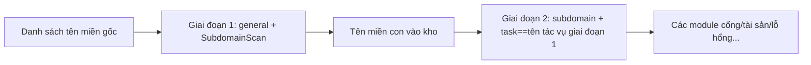

---

## name: scopesentry-mcp
description: Quản lý nền tảng quét bảo mật qua ScopeSentry MCP (dự án, tác vụ, mẫu, tài sản, node). Dùng khi người dùng nhắc tới ScopeSentry, MCP, API Key, tác vụ quét, truy vấn tài sản.

# Hướng dẫn sử dụng ScopeSentry MCP

Dành cho người dùng **đã triển khai sẵn instance ScopeSentry**. Kết nối tới nền tảng qua Cursor (hoặc MCP client khác), không cần mã nguồn ở cục bộ.

## 1. Chuẩn bị

### 1.1 Xác nhận dịch vụ truy cập được

- Giao diện Web mặc định: `http://<máy_chủ>`
- Endpoint MCP: `http://<máy_chủ>/mcp` (nếu phía trước có reverse proxy hoặc frontend proxy, lấy địa chỉ `/mcp` thực tế làm chuẩn)

### 1.2 Tạo API Key

1. Đăng nhập giao diện Web ScopeSentry bằng trình duyệt
2. Vào trang quản lý **API Key** để tạo khóa (hoặc tạo qua interface do quản trị viên cung cấp)
3. Lưu lại chuỗi `ssk_...` trả về (**chỉ hiển thị một lần**)

### 1.3 Cấu hình Cursor MCP

Cursor → Settings → MCP → thêm máy chủ:

```json
{
  "mcpServers": {
    "scopesentry": {
      "url": "http://<máy_chủ_của_bạn>:8082/mcp",
      "headers": {
        "X-API-Key": "ssk_khóa_của_bạn"
      }
    }
  }
}
```

Cũng có thể dùng: `Authorization: Bearer ssk_khóa_của_bạn`

Sau khi cấu hình xong, khởi động lại MCP hoặc reload Cursor, xác nhận trong danh sách công cụ xuất hiện `list_projects`, `list_assets`...

---

## 2. Danh sách công cụ


| Công cụ                | Công dụng           |
| ---------------------- | ----------------- |
| `list_projects`        | Cây dự án nhóm theo tag (gồm ID dự án) |
| `list_projects_data`   | Danh sách dự án phân trang, có thể tìm theo tên |
| `get_project`          | Chi tiết dự án      |
| `create_project`       | Tạo mới dự án       |
| `list_tasks`           | Danh sách tác vụ quét |
| `get_task`             | Chi tiết tác vụ     |
| `list_scan_templates`  | Danh sách mẫu quét  |
| `get_scan_template`    | Chi tiết mẫu        |
| `list_plugin_modules`  | Tên module pipeline quét |
| `list_plugins`         | Plugin khả dụng (gồm hash, tham số mặc định) |
| `create_scan_template` | Tạo mẫu quét        |
| `create_scan_task`     | Tạo tác vụ quét     |
| `list_assets`          | Truy vấn các loại tài sản (danh sách phân trang) |
| `count_assets`         | Đếm số lượng tài sản (`/api/assets/common/total`) |
| `get_asset_detail`     | Chi tiết tài sản hoặc lỗ hổng |
| `add_asset_tag`        | Thêm tag cho tài sản |
| `list_nodes`           | Danh sách node quét |


Tham số từng công cụ lấy theo mô tả công cụ MCP (schema) làm chuẩn; cú pháp search, filter của `list_assets` / `count_assets` giống nhau, trước khi truy vấn tài sản có thể đọc trước description của `list_assets`.

Khi cần biết "tổng cộng bao nhiêu bản ghi" thì dùng `count_assets` (tương ứng interface tổng phân trang của Web), không cần lật trang `list_assets` liên tục chỉ để đếm.

---

## 3. Workflow thường dùng

### 3.1 Tra tài sản theo dự án

Khi người dùng hoặc ngữ cảnh **đã có điều kiện dự án**, ưu tiên truyền `filter.project` để thu hẹp phạm vi, tránh dữ liệu liên dự án quá nhiều làm phản hồi chậm. Nếu không có dự án rõ ràng thì không bắt buộc thêm bộ lọc dự án.

1. `list_projects` hoặc `list_projects_data` lấy **ObjectID** của dự án đích (`id` / `children[].value`)
2. `list_assets` truyền `filter.project` (**phải là ID, không được viết tên dự án**)

```json
{
  "asset_type": "asset",
  "pageIndex": 1,
  "pageSize": 20,
  "search": "domain=^example.com",
  "filter": {
    "project": ["<ObjectID_dự_án>"]
  }
}
```

### 3.2 Tạo tác vụ quét

1. `list_nodes` lấy tên node đang online
2. `list_scan_templates` hoặc `create_scan_template` lấy **ObjectID** mẫu
3. `create_scan_task`: `name`, `node` bắt buộc, `template` điền ID mẫu (không được điền tên mẫu)

**Nguồn mục tiêu `targetSource` (nhất quán với Web):**

| targetSource | Giải thích | Tham số bắt buộc |
| --- | --- | --- |
| `general` | Nhập mục tiêu trực tiếp | `target` |
| `project` | Đọc mục tiêu từ dự án | `project` (mảng ObjectID dự án) |
| `asset` | Tìm từ kho tài sản Web | `search`; tùy chọn `project`, `filter`, `targetNumber` |
| `RootDomain` | Tìm từ kho tên miền gốc | `search`; tùy chọn `project`, `filter`, `targetNumber` |
| `subdomain` | Tìm từ kho tên miền con | `search`; tùy chọn `project`, `filter`, `targetNumber` |
| `UrlScan` | Tìm từ kết quả quét URL | `search`; tùy chọn `project`, `filter`, `targetNumber` |
| `*Source` (như `subdomainSource`) | Tạo từ trang tài sản "đã chọn/tìm kiếm" | khi `targetTp=search` dùng `search`; khi `targetTp=select` dùng `targetIds` |

**Ví dụ — quét trực tiếp tên miền gốc:**

```json
{
  "name": "example-thu-thập-tên-miền-con",
  "node": ["node-1"],
  "template": "<ObjectID_mẫu>",
  "targetSource": "general",
  "target": "example.com\nfoo.com",
  "project": ["<ObjectID_dự_án>"]
}
```

**Ví dụ — quét tiếp từ kho tên miền con (lọc theo tên tác vụ trước):**

```json
{
  "name": "example-cổng-và-lỗ-hổng",
  "node": ["node-1"],
  "template": "<ObjectID_mẫu_module_tiếp_theo>",
  "targetSource": "subdomain",
  "search": "task==\"example-thu-thập-tên-miền-con\"",
  "project": ["<ObjectID_dự_án>"]
}
```

### 3.3 Thu thập thông tin đầy đủ cho tên miền gốc (khuyến nghị hai giai đoạn)

Khi đầu vào là **tên miền gốc** và cần **thu thập thông tin đầy đủ**, nên chia thành hai lần quét, không chạy toàn bộ pipeline một lần.

**Lý do:** tác vụ phân tán được phân phối theo **từng mục tiêu đơn lẻ**. Khi tên miền gốc là mục tiêu, sau khi một node nhận tên miền gốc đó, các tên miền con quét ra trên node này cũng sẽ tiếp tục chạy các module tiếp theo trên chính node đó, dễ gây mất cân bằng tải, chậm, dễ lỗi.

**Thực hành tốt nhất:**

1. **Giai đoạn 1 — chỉ thu thập tên miền con**
   - `targetSource`: `general`
   - `target`: tất cả tên miền gốc (nhiều dòng)
   - Mẫu: chỉ bật `SubdomainScan`, `SubdomainSecurity` (quét tên miền con + chiếm đoạt tên miền con)
   - Dùng `get_task` chờ tác vụ hoàn thành

2. **Giai đoạn 2 — các module tiếp theo**
   - `targetSource`: `subdomain`
   - `search`: `task=="<tên tác vụ giai đoạn 1>"` (khớp chính xác tên tác vụ)
   - tùy chọn `project` để thu hẹp phạm vi
   - Mẫu: quét cổng, lập bản đồ tài sản, quét lỗ hổng... (có thể không chứa SubdomainScan)
   - Tên miền con được phân phối như mục tiêu độc lập tới các node, hiệu quả song song cao hơn

Cũng có thể ở trang tài sản "tên miền con" trên giao diện Web, lọc theo tên tác vụ rồi dùng "tạo tác vụ từ tên miền con", hiệu quả tương đương.



### 3.4 Tạo mẫu quét

1. `list_plugin_modules` → danh sách tên module
2. `list_plugins` (có thể lọc theo `module`) → `hash` của từng plugin và `parameter` mặc định
3. `create_scan_template`: dùng `modules` để chỉ định "module → mảng hash plugin"

---

## 4. Truy vấn tài sản (`list_assets` / `count_assets`)

`count_assets` và `list_assets` dùng chung `asset_type`, `search`, `filter`, trả về `{ "total": N }`, tương ứng `/api/assets/common/total` của Web.

```json
{
  "asset_type": "subdomain",
  "search": "task==\"tên-tác-vụ-nào-đó\"",
  "filter": {"project": ["<ObjectID_dự_án>"]}
}
```

**Gợi ý hiệu năng (dùng chung cho `list_assets` / `count_assets`):** khi có điều kiện dự án, ưu tiên dùng `filter.project` để thu hẹp phạm vi; trong `search`, với các trường đã đánh chỉ mục nên dùng `==` so khớp tuyệt đối hoặc `^` khớp tiền tố (xem [4.3](#43-biểu-thức-tìm-kiếm-search)), tránh truy vấn mờ `=` diện rộng làm chậm phản hồi. Khi không có ngữ cảnh dự án thì không bắt buộc thêm bộ lọc dự án.

Các loại hỗ trợ `filter.project` xem bảng ở [4.4](#44-lọc-chính-xác-filter).

### 4.1 Loại tài sản `asset_type`

`asset`、`RootDomain`、`subdomain`、`app`、`mp`、`UrlScan`、`SensitiveResult`、`DirScanResult`、`crawler`、`vulnerability`、`PageMonitoring`、`IPAsset`、`SubdomainTakerResult`

Ví dụ alias: `web`→asset、`vuln`→vulnerability、`ip`→IPAsset、`url`→UrlScan

### 4.2 Giải thích tham số


| Tham số                   | Giải thích                                |
| ------------------------ | --------------------------------------- |
| `pageIndex` / `pageSize` | Phân trang, mặc định 1 / 20                 |
| `search`                 | Biểu thức tìm kiếm (xem mục sau)          |
| `filter`                 | JSON lọc chính xác (xem mục sau)          |
| `sort`                   | Chỉ UrlScan, DirScanResult hỗ trợ sắp xếp theo `length` |
| `sid`                    | Chỉ SensitiveResult: tên rule nhạy cảm    |


`search` và `filter` **có thể dùng đồng thời**.

### 4.3 Biểu thức tìm kiếm search

DSL tự định nghĩa (**không phải SQL**):


| Toán tử | Ý nghĩa | Chỉ mục | Ví dụ                        |
| ---- | ---- | ---- | --------------------------- |
| `=`  | khớp mờ (regex) | không đi chỉ mục | `domain=example`            |
| `==` | khớp chính xác (tuyệt đối) | **đi chỉ mục** | `port==443`                 |
| `!=` | loại trừ | — | `port!="80"`                |
| `&&` | và    | — | `domain==example.com && port==443` |
| `||` | hoặc  | — | `title=admin || body=login` |


**Chỉ mục và toán tử:** các trường `domain`, `ip`, `port`, `title`... đã đánh chỉ mục, nhưng chỉ **`==` so khớp tuyệt đối** hoặc **khớp tiền tố với giá trị bắt đầu bằng `^`** (như `domain=^example.com`) mới đi chỉ mục; **`=` sẽ chuyển thành khớp mờ regex, không dùng được chỉ mục**, dữ liệu lớn dễ bị chậm.

**Trường search dùng chung cho mọi loại:** `tag`, `task` (tên tác vụ), `rootDomain`

**Không viết project trong search** (vô hiệu hoặc báo lỗi khi kết hợp với `&&`). Để lọc dự án hãy dùng `filter.project`.

**Trường search thường dùng theo từng loại:**


| asset_type           | Trường                                                                                |
| -------------------- | ----------------------------------------------------------------------------------- |
| asset                | domain, ip, port, service, app, title, statuscode, icon, banner, type, body, header |
| RootDomain           | domain, icp, company                                                                |
| subdomain            | domain, ip, type, value                                                             |
| app                  | name, icp, company, category, description, url, apk                                 |
| mp                   | name, icp, company, category, description, url                                      |
| UrlScan              | url, input, source, resultId, type                                                  |
| SensitiveResult      | url, sname, body, info, md5                                                         |
| DirScanResult        | url, statuscode, redirect, length                                                   |
| vulnerability        | url, vulname, matched, request, response, level                                     |
| crawler              | url, method, body, resultId                                                         |
| PageMonitoring       | url, hash, diff, response                                                           |
| IPAsset              | ip, domain, port, service, webServer, app                                           |
| SubdomainTakerResult | domain, value, type, response                                                       |


**Ví dụ search:**

- `domain==www.example.com && port==443` (so khớp tuyệt đối, đi chỉ mục)
- `domain=^example.com` (khớp tiền tố, đi chỉ mục)
- `ip==192.168.1.1`
- `task=="tên-tác-vụ-nào-đó"`
- `level==high` (vulnerability)
- `statuscode==200` (DirScanResult)

Khi cần khớp mờ chứa thì mới dùng `=`, vd `title=admin` (không đi chỉ mục, nên kết hợp điều kiện dự án để thu hẹp phạm vi).

### 4.4 Lọc chính xác filter

Đối tượng JSON: nhiều giá trị cùng key là **OR**, khác key là **AND**.

**Khi có điều kiện dự án, ưu tiên dùng `project`:** nếu người dùng hoặc ngữ cảnh đã rõ dự án, và asset_type hỗ trợ `project`, nên truyền vào để thu hẹp phạm vi; không có thông tin dự án thì không bắt buộc.


| filter key   | Ý nghĩa    | Giải thích giá trị                                         |
| ------------ | -------- | -------------------------------------------------------- |
| `project`    | Thuộc dự án | **ObjectID**, lấy bằng `list_projects` / `list_projects_data` |
| `task`       | Tác vụ nguồn | **Tên tác vụ**, dùng `name` của `list_tasks`               |
| `port`       | Cổng      | vd `"443"`                                                |
| `service`    | Dịch vụ/giao thức | vd `"https"`                                       |
| `app`        | Dấu vân tay ứng dụng | vd `"Nginx"`                                    |
| `icon`       | hash icon |                                                          |
| `statuscode` | Mã trạng thái HTTP | chủ yếu dùng cho asset                            |
| `status`     | Trạng thái | mã HTTP của UrlScan/DirScan; trạng thái xử lý lỗ hổng/thông tin nhạy cảm |
| `level`      | Mức lỗ hổng | critical / high / medium / low / info                    |
| `type`       | Loại      | vd loại bản ghi tên miền con A, CNAME                     |
| `color`      | Màu rule nhạy cảm | SensitiveResult                                 |
| `sname`      | Tên rule nhạy cảm | SensitiveResult                                  |
| `tags`       | Tag       |                                                          |


**filter key khả dụng theo từng loại:**


| asset_type                            | filter key                                                      |
| ------------------------------------- | --------------------------------------------------------------- |
| asset                                 | project, port, service, app, icon, statuscode, type, task, tags |
| RootDomain                            | project, tags                                                   |
| subdomain                             | project, type, task, tags                                       |
| app / mp                              | project, tags                                                   |
| UrlScan                               | status, tags                                                    |
| DirScanResult                         | status, tags                                                    |
| SensitiveResult                       | status, color, sname, tags                                      |
| crawler                               | project, task, tags                                             |
| vulnerability                         | project, level, status, task, tags                              |
| PageMonitoring / SubdomainTakerResult | tags                                                            |
| IPAsset                               | project, port, service, app                                     |


**Ví dụ filter:**

```json
{"project": ["<ObjectID_dự_án>"], "port": ["443"]}
```

**Ví dụ truy vấn kết hợp:**

```json
{
  "asset_type": "asset",
  "search": "domain=^baidu && port==443",
  "filter": {"project": ["<ObjectID_dự_án>"]},
  "pageIndex": 1,
  "pageSize": 10
}
```

**Lưu ý:**

- Khi có điều kiện dự án thì ưu tiên kèm `filter.project` (khi được hỗ trợ); không có ngữ cảnh dự án thì không bắt buộc
- `filter.project` không điền tên hiển thị của dự án
- Giá trị đã biết dùng `==`, tiền tố dùng `^`; tránh lạm dụng khớp mờ `=` trên bảng lớn
- Trạng thái HTTP của UrlScan dùng `filter.status`; DirScanResult có thể dùng `statuscode==200` trong search
- SensitiveResult theo tên rule: trong `search` dùng `sname=tên_rule`, hoặc `filter.sname`

### 4.5 Sắp xếp sort

Chỉ **UrlScan**, **DirScanResult** hỗ trợ:

```json
{"length": "ascending"}
```

Các loại khác bỏ qua `sort`, sắp xếp mặc định theo thời gian.

---

## 5. Tên module mẫu quét

`TargetHandler`、`SubdomainScan`、`SubdomainSecurity`、`PortScanPreparation`、`PortScan`、`PortFingerprint`、`AssetMapping`、`AssetHandle`、`URLScan`、`WebCrawler`、`URLSecurity`、`DirScan`、`VulnerabilityScan`、`PassiveScan`

---

## 6. Xử lý sự cố


| Hiện tượng  | Xử lý                                                |
| --------- | -------------------------------------------------- |
| MCP không có công cụ | Kiểm tra URL, API Key, ScopeSentry có đang chạy không |
| 401 / 403 | Tạo lại hoặc thay API Key                            |
| Không tra được tài sản | Xác nhận `filter.project` là ObjectID; không viết project trong search |
| Tạo mẫu/tác vụ thất bại | `template` phải là ObjectID mẫu; `node` điền tên node đang online |
| Truy vấn rất chậm/treo | Có dự án thì thêm `filter.project`; trong search với trường đã đánh chỉ mục đổi sang `==` hoặc tiền tố `^`, ít dùng `=`; giảm `pageSize` |


---
